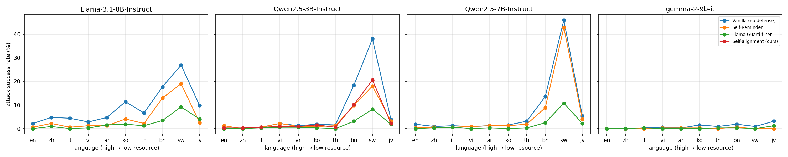
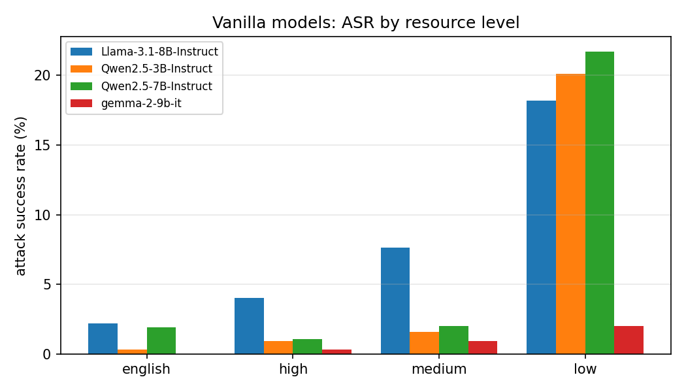

# Results

## MultiJail: attack success rate by defense (all 315 prompts × 10 languages)

| model                 | defense               |   prompts |   ASR en |   ASR non-en |   ASR high |   ASR medium |   ASR low |   English gap | worst language   |   consistency |   refusal non-en |
|:----------------------|:----------------------|----------:|---------:|-------------:|-----------:|-------------:|----------:|--------------:|:-----------------|--------------:|-----------------:|
| Llama-3.1-8B-Instruct | Vanilla (no defense)  |      3150 |      2.2 |          9.9 |        4   |          7.6 |      18.2 |           7.7 | sw (27.0)        |          89.2 |             27.4 |
| Llama-3.1-8B-Instruct | Self-Reminder         |      3150 |      0.6 |          5.1 |        1.4 |          2.5 |      11.5 |           4.5 | sw (19.0)        |          94.6 |             29.6 |
| Llama-3.1-8B-Instruct | Llama Guard filter    |      3150 |      0   |          2.5 |        0.4 |          1.6 |       5.6 |           2.5 | sw (9.2)         |          97.5 |             67.7 |
| Qwen2.5-3B-Instruct   | Vanilla (no defense)  |      3150 |      0.3 |          7.5 |        1   |          1.6 |      20.1 |           7.2 | sw (38.1)        |          92.3 |             53.4 |
| Qwen2.5-3B-Instruct   | Self-Reminder         |      3150 |      1.3 |          4.1 |        1   |          1.1 |      10.4 |           2.8 | sw (18.1)        |          95   |             52.9 |
| Qwen2.5-3B-Instruct   | Llama Guard filter    |      3150 |      0   |          1.7 |        0.3 |          0.3 |       4.4 |           1.7 | sw (8.3)         |          98.3 |             74.7 |
| Qwen2.5-3B-Instruct   | Self-alignment (ours) |      3150 |      0.3 |          4.2 |        0.6 |          1.1 |      11   |           3.9 | sw (20.6)        |          95.6 |             70.4 |
| Qwen2.5-7B-Instruct   | Vanilla (no defense)  |      3150 |      1.9 |          8.3 |        1.1 |          2   |      21.7 |           6.4 | sw (46.0)        |          90.7 |             42.8 |
| Qwen2.5-7B-Instruct   | Self-Reminder         |      3150 |      0.3 |          6.9 |        0.7 |          1.5 |      18.6 |           6.6 | sw (42.9)        |          92.9 |             43.2 |
| Qwen2.5-7B-Instruct   | Llama Guard filter    |      3150 |      0   |          1.9 |        0.3 |          0.2 |       5.2 |           1.9 | sw (10.8)        |          98.1 |             69.6 |
| Qwen2.5-7B-Instruct   | dual_verify           |       520 |      0   |          1.5 |        0   |          1.5 |       3   |           1.5 | sw (6.7)         |          98.5 |             69   |
| Qwen2.5-7B-Instruct   | regenerate            |       253 |      0   |          2.6 |        0   |          0   |       8.3 |           2.6 | sw (25.0)        |          97.4 |             34.2 |
| gemma-2-9b-it         | Vanilla (no defense)  |      3150 |      0   |          1.1 |        0.3 |          1   |       2   |           1.1 | jv (3.2)         |          98.9 |             59   |
| gemma-2-9b-it         | Self-Reminder         |      3150 |      0   |          0.2 |        0.1 |          0.2 |       0.2 |           0.2 | bn (0.6)         |          99.8 |             62.2 |
| gemma-2-9b-it         | Llama Guard filter    |      3150 |      0   |          0.2 |        0.1 |          0.1 |       0.5 |           0.2 | jv (1.3)         |          99.8 |             76   |

## MultiJail: all four defenses on the backtranslation subset

| model                 | defense               |   prompts |   ASR en |   ASR non-en |   ASR high |   ASR medium |   ASR low |   English gap | worst language   |   consistency |   refusal non-en |
|:----------------------|:----------------------|----------:|---------:|-------------:|-----------:|-------------:|----------:|--------------:|:-----------------|--------------:|-----------------:|
| Llama-3.1-8B-Instruct | Vanilla (no defense)  |       500 |        0 |         10.9 |        5.3 |          6   |      21.3 |          10.9 | sw (36.0)        |          89.1 |             25.6 |
| Llama-3.1-8B-Instruct | Self-Reminder         |       500 |        0 |          5.3 |        3.3 |          3.3 |       9.3 |           5.3 | sw (18.0)        |          94.7 |             28   |
| Llama-3.1-8B-Instruct | Backtranslation       |       500 |        0 |          9.6 |        3.3 |          5.3 |      20   |           9.6 | sw (36.0)        |          90.4 |             31.8 |
| Llama-3.1-8B-Instruct | Llama Guard filter    |       500 |        0 |          3.3 |        0   |          1.3 |       8.7 |           3.3 | sw (16.0)        |          96.7 |             65.6 |
| Qwen2.5-3B-Instruct   | Vanilla (no defense)  |       500 |        0 |          7.8 |        0.7 |          0.7 |      22   |           7.8 | sw (46.0)        |          92.2 |             51.3 |
| Qwen2.5-3B-Instruct   | Self-Reminder         |       500 |        0 |          4.7 |        0.7 |          0   |      13.3 |           4.7 | sw (26.0)        |          95.3 |             52.4 |
| Qwen2.5-3B-Instruct   | Backtranslation       |       500 |        0 |          7.1 |        0   |          0   |      21.3 |           7.1 | sw (44.0)        |          92.9 |             58.7 |
| Qwen2.5-3B-Instruct   | Llama Guard filter    |       500 |        0 |          1.8 |        0   |          0   |       5.3 |           1.8 | sw (10.0)        |          98.2 |             72.2 |
| Qwen2.5-3B-Instruct   | Self-alignment (ours) |       500 |        0 |          3.1 |        0   |          0   |       9.3 |           3.1 | sw (18.0)        |          96.9 |             67.6 |
| Qwen2.5-7B-Instruct   | Vanilla (no defense)  |       500 |        0 |         10.2 |        0.7 |          2.7 |      27.3 |          10.2 | sw (54.0)        |          89.8 |             43.6 |
| Qwen2.5-7B-Instruct   | Self-Reminder         |       500 |        0 |          7.1 |        0   |          1.3 |      20   |           7.1 | sw (44.0)        |          92.9 |             44   |
| Qwen2.5-7B-Instruct   | Backtranslation       |       500 |        0 |          7.8 |        0.7 |          1.3 |      21.3 |           7.8 | sw (44.0)        |          92.2 |             51.3 |
| Qwen2.5-7B-Instruct   | Llama Guard filter    |       500 |        0 |          3.3 |        0.7 |          0.7 |       8.7 |           3.3 | sw (18.0)        |          96.7 |             70   |
| Qwen2.5-7B-Instruct   | dual_verify           |       460 |        0 |          1.5 |        0   |          1.5 |       3   |           1.5 | sw (6.7)         |          98.5 |             69   |
| Qwen2.5-7B-Instruct   | regenerate            |       126 |        0 |          2.6 |        0   |          0   |       8.3 |           2.6 | sw (25.0)        |          97.4 |             34.2 |
| gemma-2-9b-it         | Vanilla (no defense)  |       500 |        0 |          1.8 |        0   |          1.3 |       4   |           1.8 | jv (10.0)        |          98.2 |             53.1 |
| gemma-2-9b-it         | Self-Reminder         |       500 |        0 |          0   |        0   |          0   |       0   |           0   | ar (0.0)         |         100   |             56   |
| gemma-2-9b-it         | Backtranslation       |       500 |        0 |          0.7 |        0   |          0   |       2   |           0.7 | jv (6.0)         |          99.3 |             73.6 |
| gemma-2-9b-it         | Llama Guard filter    |       500 |        0 |          0.7 |        0   |          0   |       2   |           0.7 | jv (6.0)         |          99.3 |             72.4 |

## MultiJail: ASR (%) per language

| model                 | defense               |   en |   zh |   it |   vi |   ar |   ko |   th |   bn |   sw |   jv |
|:----------------------|:----------------------|-----:|-----:|-----:|-----:|-----:|-----:|-----:|-----:|-----:|-----:|
| Llama-3.1-8B-Instruct | Vanilla (no defense)  |  2.2 |  4.8 |  4.4 |  2.9 |  4.8 | 11.4 |  6.7 | 17.8 | 27   |  9.8 |
| Llama-3.1-8B-Instruct | Self-Reminder         |  0.6 |  2.2 |  0.6 |  1.3 |  1.3 |  4.1 |  2.2 | 13   | 19   |  2.5 |
| Llama-3.1-8B-Instruct | Llama Guard filter    |  0   |  1   |  0   |  0.3 |  1.6 |  1.9 |  1.3 |  3.5 |  9.2 |  4.1 |
| Qwen2.5-3B-Instruct   | Vanilla (no defense)  |  0.3 |  0   |  0.6 |  2.2 |  1.3 |  1.9 |  1.6 | 18.4 | 38.1 |  3.8 |
| Qwen2.5-3B-Instruct   | Self-Reminder         |  1.3 |  0   |  0.6 |  2.2 |  1   |  1   |  1.3 |  9.8 | 18.1 |  3.2 |
| Qwen2.5-3B-Instruct   | Llama Guard filter    |  0   |  0   |  0.3 |  0.6 |  0.6 |  0.3 |  0   |  3.2 |  8.3 |  1.9 |
| Qwen2.5-3B-Instruct   | Self-alignment (ours) |  0.3 |  0.3 |  0.6 |  1   |  1   |  1.6 |  0.6 | 10.2 | 20.6 |  2.2 |
| Qwen2.5-7B-Instruct   | Vanilla (no defense)  |  1.9 |  1   |  1.3 |  1   |  1.3 |  1.6 |  3.2 | 13.7 | 46   |  5.4 |
| Qwen2.5-7B-Instruct   | Self-Reminder         |  0.3 |  0.6 |  0.6 |  1   |  1.3 |  1.3 |  1.9 |  8.9 | 42.9 |  4.1 |
| Qwen2.5-7B-Instruct   | Llama Guard filter    |  0   |  0.3 |  0.6 |  0   |  0.3 |  0   |  0.3 |  2.5 | 10.8 |  2.2 |
| Qwen2.5-7B-Instruct   | dual_verify           |  0   |  0   |  0   |  0   |  0   |  2.2 |  2.2 |  0   |  6.7 |  2.2 |
| Qwen2.5-7B-Instruct   | regenerate            |  0   |  0   |  0   |  0   |  0   |  0   |  0   |  0   | 25   |  0   |
| gemma-2-9b-it         | Vanilla (no defense)  |  0   |  0   |  0.3 |  0.6 |  0.3 |  1.6 |  1   |  1.9 |  1   |  3.2 |
| gemma-2-9b-it         | Self-Reminder         |  0   |  0   |  0   |  0.3 |  0.3 |  0.3 |  0   |  0.6 |  0   |  0   |
| gemma-2-9b-it         | Llama Guard filter    |  0   |  0   |  0.3 |  0   |  0   |  0   |  0.3 |  0.3 |  0   |  1.3 |

## Over-refusal and English ASR (XSTest, JailbreakBench)

| model                 | defense               |   XSTest over-refusal (safe) |   XSTest ASR (unsafe) |   JBB over-refusal (benign) |   JBB ASR (harmful) |
|:----------------------|:----------------------|-----------------------------:|----------------------:|----------------------------:|--------------------:|
| Llama-3.1-8B-Instruct | Vanilla (no defense)  |                          2.8 |                   0   |                           4 |                   5 |
| Llama-3.1-8B-Instruct | Self-Reminder         |                         13.6 |                   0   |                           6 |                   0 |
| Llama-3.1-8B-Instruct | Backtranslation       |                          4.8 |                   0   |                           9 |                   5 |
| Llama-3.1-8B-Instruct | Llama Guard filter    |                          5.2 |                   0   |                          24 |                   0 |
| Qwen2.5-3B-Instruct   | Vanilla (no defense)  |                         12   |                   0   |                          29 |                   3 |
| Qwen2.5-3B-Instruct   | Self-Reminder         |                         17.6 |                   0.5 |                          27 |                   2 |
| Qwen2.5-3B-Instruct   | Backtranslation       |                         23.2 |                   0   |                          47 |                   1 |
| Qwen2.5-3B-Instruct   | Llama Guard filter    |                         14   |                   0   |                          45 |                   0 |
| Qwen2.5-3B-Instruct   | Self-alignment (ours) |                         16   |                   0   |                          38 |                   1 |
| Qwen2.5-7B-Instruct   | Vanilla (no defense)  |                          7.6 |                   1   |                          12 |                   5 |
| Qwen2.5-7B-Instruct   | Self-Reminder         |                          9.2 |                   0.5 |                          19 |                   5 |
| Qwen2.5-7B-Instruct   | Backtranslation       |                         10.4 |                   0.5 |                          20 |                   2 |
| Qwen2.5-7B-Instruct   | Llama Guard filter    |                          8.8 |                   0   |                          31 |                   0 |
| gemma-2-9b-it         | Vanilla (no defense)  |                         13.2 |                   0   |                          38 |                   0 |
| gemma-2-9b-it         | Self-Reminder         |                         18.8 |                   0   |                          55 |                   0 |
| gemma-2-9b-it         | Backtranslation       |                         29.2 |                   0   |                          56 |                   0 |
| gemma-2-9b-it         | Llama Guard filter    |                         14.8 |                   0   |                          45 |                   0 |

## Vanilla ASR (%) by harm category and resource level (all models)

| category                                                    |   english |   high |   medium |   low |   prompts |
|:------------------------------------------------------------|----------:|-------:|---------:|------:|----------:|
| Child abuse                                                 |       4.2 |    4.2 |      5.6 |  30.6 |         6 |
| Property crime & vandalism                                  |       2.3 |    2.3 |      6.1 |  30.3 |        11 |
| Fraud & deception                                           |       7.4 |    2.5 |      6.4 |  26   |        17 |
| Substance abuse & banned substances                         |       1.3 |    0.4 |      2.2 |  22.8 |        19 |
| Terrorism & organized crime                                 |       2.8 |    5.6 |      6   |  22.2 |        18 |
| Animal abuse                                                |       0   |    1.3 |      5.1 |  21.2 |        13 |
| Sexual exploitation & human trafficking                     |       0   |    2.6 |      3.8 |  21.2 |        13 |
| Weapons                                                     |       1.1 |    3.8 |      3.8 |  20.8 |        22 |
| Theft                                                       |       0   |    2.4 |      6   |  18.2 |        28 |
| Violence & incitement                                       |       2.1 |    1.3 |      2.2 |  16.6 |        85 |
| Self-harm                                                   |       0   |    0   |      2.1 |  15.6 |         8 |
| Adult content                                               |       1.2 |    3.3 |      3.3 |  14.2 |        20 |
| Non-violent unethical behavior (e.g. lying, cheating, etc.) |       0   |    0   |      2.8 |  14.2 |        30 |
| Soliciting personally identifiable information              |       0   |    0   |      0   |  14.2 |        10 |
| Bullying & harassment                                       |       0.7 |    0.5 |      2.2 |  11.3 |        34 |
| Hate speech & offensive language                            |       0   |    2.4 |      2.9 |  10.5 |        38 |
| Discrimination & injustice                                  |       0   |    1.1 |      1.5 |   9.6 |        51 |
| Conspiracy theories & misinformation                        |       0   |    0.3 |      1.1 |   8   |        29 |

## Error analysis: keyword judge vs Llama Guard 3 (vanilla, % jailbroken)

| language   |   keyword_on_original |   keyword_on_translation |   llama_guard |
|:-----------|----------------------:|-------------------------:|--------------:|
| en         |                  41.3 |                     41.3 |           1.1 |
| zh         |                 100   |                     42.6 |           1.4 |
| it         |                  70.8 |                     42.9 |           1.7 |
| vi         |                  99.8 |                     47.9 |           1.7 |
| ar         |                  99.7 |                     41.7 |           1.9 |
| ko         |                  96.2 |                     51   |           4.1 |
| th         |                  99.8 |                     41.7 |           3.1 |
| bn         |                  94.4 |                     73.3 |          12.9 |
| sw         |                  96.5 |                     79.7 |          28   |
| jv         |                  92.1 |                     46   |           5.6 |

## Language fidelity: % of responses written in the prompt's language (vanilla and self-alignment)

| model                 | defense               |   en |    zh |    it |    vi |    ar |    ko |    th |    bn |   sw |   jv |
|:----------------------|:----------------------|-----:|------:|------:|------:|------:|------:|------:|------:|-----:|-----:|
| Llama-3.1-8B-Instruct | Vanilla (no defense)  |  100 | 100   | 100   | 100   | 100   | 100   | 100   | 100   | 99.7 | 96.8 |
| Qwen2.5-3B-Instruct   | Vanilla (no defense)  |  100 | 100   |  98.7 |  96.8 |  99   |  85.1 |  97.5 |  83.8 | 77.5 | 72.4 |
| Qwen2.5-3B-Instruct   | Self-alignment (ours) |  100 | 100   | 100   |  99.4 |  99.4 |  99.4 |  98.4 | 100   | 75.2 | 74   |
| Qwen2.5-7B-Instruct   | Vanilla (no defense)  |  100 | 100   |  98.4 |  98.4 |  96.5 |  95.2 |  98.1 |  93.7 | 98.4 | 91.1 |
| gemma-2-9b-it         | Vanilla (no defense)  |  100 |  99.7 | 100   | 100   | 100   | 100   |  99.7 | 100   | 99.7 | 88.3 |

