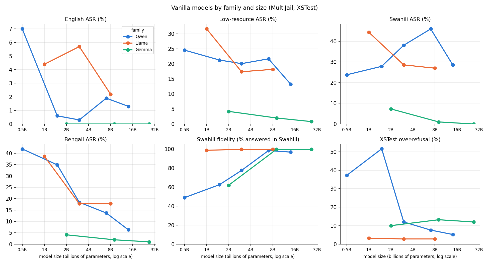
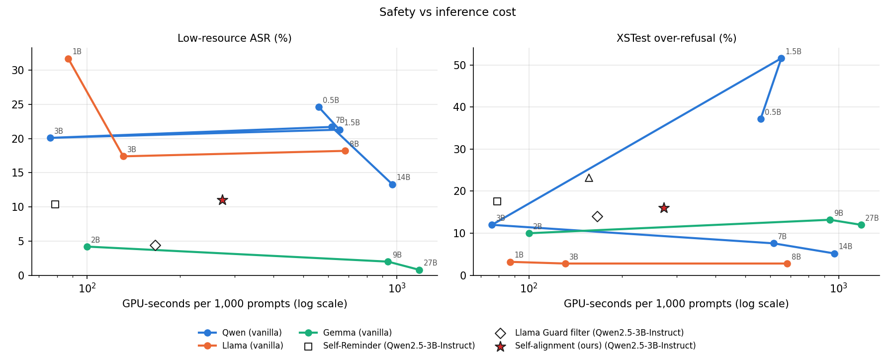

# Results

## MultiJail: attack success rate by defense (all 315 prompts × 10 languages)

| model                 | defense               |   prompts |   ASR en |   ASR non-en |   ASR high |   ASR medium |   ASR low |   English gap | worst language   |   consistency |   refusal non-en |
|:----------------------|:----------------------|----------:|---------:|-------------:|-----------:|-------------:|----------:|--------------:|:-----------------|--------------:|-----------------:|
| Llama-3.1-8B-Instruct | Vanilla (no defense)  |      3150 |      2.2 |          9.9 |        4   |          7.6 |      18.2 |           7.7 | sw (27.0)        |          89.2 |             27.4 |
| Llama-3.1-8B-Instruct | Self-Reminder         |      3150 |      0.6 |          5.1 |        1.4 |          2.5 |      11.5 |           4.5 | sw (19.0)        |          94.6 |             29.6 |
| Llama-3.1-8B-Instruct | Llama Guard filter    |      3150 |      0   |          2.5 |        0.4 |          1.6 |       5.6 |           2.5 | sw (9.2)         |          97.5 |             67.7 |
| Llama-3.2-1B-Instruct | Vanilla (no defense)  |      3150 |      4.4 |         17.6 |        6.6 |         14.4 |      31.7 |          13.2 | sw (44.4)        |          81.1 |             32   |
| Llama-3.2-1B-Instruct | Llama Guard filter    |      3150 |      0   |          3   |        0.6 |          1.7 |       6.8 |           3   | sw (11.1)        |          97   |             71.1 |
| Llama-3.2-3B-Instruct | Vanilla (no defense)  |      3150 |      5.7 |         10.1 |        4.4 |          8.5 |      17.4 |           4.4 | sw (28.6)        |          86.5 |             34.1 |
| Llama-3.2-3B-Instruct | Llama Guard filter    |      3150 |      0   |          1.6 |        0.4 |          0.7 |       3.7 |           1.6 | sw (6.3)         |          98.4 |             68.7 |
| Qwen2.5-0.5B-Instruct | Vanilla (no defense)  |      3150 |      7   |         16.3 |        9.6 |         14.7 |      24.6 |           9.3 | bn (41.9)        |          82.4 |             46.1 |
| Qwen2.5-0.5B-Instruct | Llama Guard filter    |      3150 |      0   |          2   |        0.6 |          1.6 |       3.9 |           2   | sw (5.4)         |          98   |             76.7 |
| Qwen2.5-1.5B-Instruct | Vanilla (no defense)  |      3150 |      0.6 |          8.6 |        1.4 |          3.3 |      21.3 |           8   | bn (34.9)        |          91.3 |             59.8 |
| Qwen2.5-1.5B-Instruct | Llama Guard filter    |      3150 |      0   |          1.3 |        0.1 |          0.8 |       2.9 |           1.3 | sw (4.8)         |          98.7 |             79.8 |
| Qwen2.5-14B-Instruct  | Vanilla (no defense)  |      3150 |      1.3 |          4.8 |        0.6 |          0.4 |      13.3 |           3.5 | sw (28.6)        |          94.3 |             44.9 |
| Qwen2.5-14B-Instruct  | Llama Guard filter    |      3150 |      0   |          0.9 |        0   |          0.2 |       2.5 |           0.9 | sw (5.4)         |          99.1 |             68.9 |
| Qwen2.5-3B-Instruct   | Vanilla (no defense)  |      3150 |      0.3 |          7.5 |        1   |          1.6 |      20.1 |           7.2 | sw (38.1)        |          92.3 |             53.4 |
| Qwen2.5-3B-Instruct   | Self-Reminder         |      3150 |      1.3 |          4.1 |        1   |          1.1 |      10.4 |           2.8 | sw (18.1)        |          95   |             52.9 |
| Qwen2.5-3B-Instruct   | Llama Guard filter    |      3150 |      0   |          1.7 |        0.3 |          0.3 |       4.4 |           1.7 | sw (8.3)         |          98.3 |             74.7 |
| Qwen2.5-3B-Instruct   | Self-alignment (ours) |      3150 |      0.3 |          4.2 |        0.6 |          1.1 |      11   |           3.9 | sw (20.6)        |          95.6 |             70.4 |
| Qwen2.5-7B-Instruct   | Vanilla (no defense)  |      3150 |      1.9 |          8.3 |        1.1 |          2   |      21.7 |           6.4 | sw (46.0)        |          90.7 |             42.8 |
| Qwen2.5-7B-Instruct   | Self-Reminder         |      3150 |      0.3 |          6.9 |        0.7 |          1.5 |      18.6 |           6.6 | sw (42.9)        |          92.9 |             43.2 |
| Qwen2.5-7B-Instruct   | Llama Guard filter    |      3150 |      0   |          1.9 |        0.3 |          0.2 |       5.2 |           1.9 | sw (10.8)        |          98.1 |             69.6 |
| Qwen2.5-7B-Instruct   | dual_verify           |       520 |      0   |          1.5 |        0   |          1.5 |       3   |           1.5 | sw (6.7)         |          98.5 |             69   |
| Qwen2.5-7B-Instruct   | regenerate            |       253 |      0   |          2.6 |        0   |          0   |       8.3 |           2.6 | sw (25.0)        |          97.4 |             34.2 |
| gemma-2-27b-it        | Vanilla (no defense)  |      3150 |      0   |          0.7 |        0.4 |          0.8 |       0.8 |           0.7 | jv (1.6)         |          99.3 |             56.8 |
| gemma-2-27b-it        | Llama Guard filter    |      3150 |      0   |          0.1 |        0   |          0.1 |       0.3 |           0.1 | bn (0.6)         |          99.9 |             75.4 |
| gemma-2-2b-it         | Vanilla (no defense)  |      3150 |      0   |          2.5 |        0.5 |          2.9 |       4.2 |           2.5 | sw (7.3)         |          97.5 |             62.4 |
| gemma-2-2b-it         | Llama Guard filter    |      3150 |      0   |          0.7 |        0   |          0.4 |       1.6 |           0.7 | sw (3.5)         |          99.3 |             76.3 |
| gemma-2-9b-it         | Vanilla (no defense)  |      3150 |      0   |          1.1 |        0.3 |          1   |       2   |           1.1 | jv (3.2)         |          98.9 |             59   |
| gemma-2-9b-it         | Self-Reminder         |      3150 |      0   |          0.2 |        0.1 |          0.2 |       0.2 |           0.2 | bn (0.6)         |          99.8 |             62.2 |
| gemma-2-9b-it         | Llama Guard filter    |      3150 |      0   |          0.2 |        0.1 |          0.1 |       0.5 |           0.2 | jv (1.3)         |          99.8 |             76   |

## MultiJail: all four defenses on the backtranslation subset

| model                 | defense               |   prompts |   ASR en |   ASR non-en |   ASR high |   ASR medium |   ASR low |   English gap | worst language   |   consistency |   refusal non-en |
|:----------------------|:----------------------|----------:|---------:|-------------:|-----------:|-------------:|----------:|--------------:|:-----------------|--------------:|-----------------:|
| Llama-3.1-8B-Instruct | Vanilla (no defense)  |       500 |        0 |         10.9 |        5.3 |          6   |      21.3 |          10.9 | sw (36.0)        |          89.1 |             25.6 |
| Llama-3.1-8B-Instruct | Self-Reminder         |       500 |        0 |          5.3 |        3.3 |          3.3 |       9.3 |           5.3 | sw (18.0)        |          94.7 |             28   |
| Llama-3.1-8B-Instruct | Backtranslation       |       500 |        0 |          9.6 |        3.3 |          5.3 |      20   |           9.6 | sw (36.0)        |          90.4 |             31.8 |
| Llama-3.1-8B-Instruct | Llama Guard filter    |       500 |        0 |          3.3 |        0   |          1.3 |       8.7 |           3.3 | sw (16.0)        |          96.7 |             65.6 |
| Qwen2.5-3B-Instruct   | Vanilla (no defense)  |       500 |        0 |          7.8 |        0.7 |          0.7 |      22   |           7.8 | sw (46.0)        |          92.2 |             51.3 |
| Qwen2.5-3B-Instruct   | Self-Reminder         |       500 |        0 |          4.7 |        0.7 |          0   |      13.3 |           4.7 | sw (26.0)        |          95.3 |             52.4 |
| Qwen2.5-3B-Instruct   | Backtranslation       |       500 |        0 |          7.1 |        0   |          0   |      21.3 |           7.1 | sw (44.0)        |          92.9 |             58.7 |
| Qwen2.5-3B-Instruct   | Llama Guard filter    |       500 |        0 |          1.8 |        0   |          0   |       5.3 |           1.8 | sw (10.0)        |          98.2 |             72.2 |
| Qwen2.5-3B-Instruct   | Self-alignment (ours) |       500 |        0 |          3.1 |        0   |          0   |       9.3 |           3.1 | sw (18.0)        |          96.9 |             67.6 |
| Qwen2.5-7B-Instruct   | Vanilla (no defense)  |       500 |        0 |         10.2 |        0.7 |          2.7 |      27.3 |          10.2 | sw (54.0)        |          89.8 |             43.6 |
| Qwen2.5-7B-Instruct   | Self-Reminder         |       500 |        0 |          7.1 |        0   |          1.3 |      20   |           7.1 | sw (44.0)        |          92.9 |             44   |
| Qwen2.5-7B-Instruct   | Backtranslation       |       500 |        0 |          7.8 |        0.7 |          1.3 |      21.3 |           7.8 | sw (44.0)        |          92.2 |             51.3 |
| Qwen2.5-7B-Instruct   | Llama Guard filter    |       500 |        0 |          3.3 |        0.7 |          0.7 |       8.7 |           3.3 | sw (18.0)        |          96.7 |             70   |
| Qwen2.5-7B-Instruct   | dual_verify           |       460 |        0 |          1.5 |        0   |          1.5 |       3   |           1.5 | sw (6.7)         |          98.5 |             69   |
| Qwen2.5-7B-Instruct   | regenerate            |       126 |        0 |          2.6 |        0   |          0   |       8.3 |           2.6 | sw (25.0)        |          97.4 |             34.2 |
| gemma-2-9b-it         | Vanilla (no defense)  |       500 |        0 |          1.8 |        0   |          1.3 |       4   |           1.8 | jv (10.0)        |          98.2 |             53.1 |
| gemma-2-9b-it         | Self-Reminder         |       500 |        0 |          0   |        0   |          0   |       0   |           0   | ar (0.0)         |         100   |             56   |
| gemma-2-9b-it         | Backtranslation       |       500 |        0 |          0.7 |        0   |          0   |       2   |           0.7 | jv (6.0)         |          99.3 |             73.6 |
| gemma-2-9b-it         | Llama Guard filter    |       500 |        0 |          0.7 |        0   |          0   |       2   |           0.7 | jv (6.0)         |          99.3 |             72.4 |

## MultiJail: ASR (%) per language

| model                 | defense               |   en |   zh |   it |   vi |   ar |   ko |   th |   bn |   sw |   jv |
|:----------------------|:----------------------|-----:|-----:|-----:|-----:|-----:|-----:|-----:|-----:|-----:|-----:|
| Llama-3.1-8B-Instruct | Vanilla (no defense)  |  2.2 |  4.8 |  4.4 |  2.9 |  4.8 | 11.4 |  6.7 | 17.8 | 27   |  9.8 |
| Llama-3.1-8B-Instruct | Self-Reminder         |  0.6 |  2.2 |  0.6 |  1.3 |  1.3 |  4.1 |  2.2 | 13   | 19   |  2.5 |
| Llama-3.1-8B-Instruct | Llama Guard filter    |  0   |  1   |  0   |  0.3 |  1.6 |  1.9 |  1.3 |  3.5 |  9.2 |  4.1 |
| Llama-3.2-1B-Instruct | Vanilla (no defense)  |  4.4 |  7.9 |  6.3 |  5.4 |  9.2 | 30.5 |  3.5 | 38.7 | 44.4 | 12.1 |
| Llama-3.2-1B-Instruct | Llama Guard filter    |  0   |  1.6 |  0   |  0.3 |  1.6 |  2.9 |  0.6 |  3.2 | 11.1 |  6   |
| Llama-3.2-3B-Instruct | Vanilla (no defense)  |  5.7 |  3.8 |  2.2 |  7.3 |  5.4 | 15.6 |  4.4 | 17.8 | 28.6 |  5.7 |
| Llama-3.2-3B-Instruct | Llama Guard filter    |  0   |  1   |  0   |  0.3 |  0.3 |  1.3 |  0.6 |  2.5 |  6.3 |  2.2 |
| Qwen2.5-0.5B-Instruct | Vanilla (no defense)  |  7   |  4.4 | 13.3 | 11.1 | 11.4 | 21.9 | 10.8 | 41.9 | 23.8 |  7.9 |
| Qwen2.5-0.5B-Instruct | Llama Guard filter    |  0   |  1   |  0.6 |  0.3 |  2.2 |  1.3 |  1.3 |  4.1 |  5.4 |  2.2 |
| Qwen2.5-1.5B-Instruct | Vanilla (no defense)  |  0.6 |  0.6 |  2.2 |  1.3 |  3.2 |  3.5 |  3.2 | 34.9 | 27.9 |  1   |
| Qwen2.5-1.5B-Instruct | Llama Guard filter    |  0   |  0   |  0.3 |  0   |  1.3 |  1   |  0.3 |  3.5 |  4.8 |  0.3 |
| Qwen2.5-14B-Instruct  | Vanilla (no defense)  |  1.3 |  0   |  1   |  1   |  0   |  0.6 |  0.6 |  6.3 | 28.6 |  5.1 |
| Qwen2.5-14B-Instruct  | Llama Guard filter    |  0   |  0   |  0   |  0   |  0   |  0.3 |  0.3 |  1   |  5.4 |  1.3 |
| Qwen2.5-3B-Instruct   | Vanilla (no defense)  |  0.3 |  0   |  0.6 |  2.2 |  1.3 |  1.9 |  1.6 | 18.4 | 38.1 |  3.8 |
| Qwen2.5-3B-Instruct   | Self-Reminder         |  1.3 |  0   |  0.6 |  2.2 |  1   |  1   |  1.3 |  9.8 | 18.1 |  3.2 |
| Qwen2.5-3B-Instruct   | Llama Guard filter    |  0   |  0   |  0.3 |  0.6 |  0.6 |  0.3 |  0   |  3.2 |  8.3 |  1.9 |
| Qwen2.5-3B-Instruct   | Self-alignment (ours) |  0.3 |  0.3 |  0.6 |  1   |  1   |  1.6 |  0.6 | 10.2 | 20.6 |  2.2 |
| Qwen2.5-7B-Instruct   | Vanilla (no defense)  |  1.9 |  1   |  1.3 |  1   |  1.3 |  1.6 |  3.2 | 13.7 | 46   |  5.4 |
| Qwen2.5-7B-Instruct   | Self-Reminder         |  0.3 |  0.6 |  0.6 |  1   |  1.3 |  1.3 |  1.9 |  8.9 | 42.9 |  4.1 |
| Qwen2.5-7B-Instruct   | Llama Guard filter    |  0   |  0.3 |  0.6 |  0   |  0.3 |  0   |  0.3 |  2.5 | 10.8 |  2.2 |
| Qwen2.5-7B-Instruct   | dual_verify           |  0   |  0   |  0   |  0   |  0   |  2.2 |  2.2 |  0   |  6.7 |  2.2 |
| Qwen2.5-7B-Instruct   | regenerate            |  0   |  0   |  0   |  0   |  0   |  0   |  0   |  0   | 25   |  0   |
| gemma-2-27b-it        | Vanilla (no defense)  |  0   |  0   |  0.3 |  1   |  0.3 |  1.3 |  1   |  1   |  0   |  1.6 |
| gemma-2-27b-it        | Llama Guard filter    |  0   |  0   |  0   |  0   |  0   |  0.3 |  0   |  0.6 |  0   |  0.3 |
| gemma-2-2b-it         | Vanilla (no defense)  |  0   |  1.3 |  0.3 |  0   |  0.6 |  6.7 |  1.3 |  4.1 |  7.3 |  1.3 |
| gemma-2-2b-it         | Llama Guard filter    |  0   |  0   |  0   |  0   |  0.3 |  0.6 |  0.3 |  1   |  3.5 |  0.3 |
| gemma-2-9b-it         | Vanilla (no defense)  |  0   |  0   |  0.3 |  0.6 |  0.3 |  1.6 |  1   |  1.9 |  1   |  3.2 |
| gemma-2-9b-it         | Self-Reminder         |  0   |  0   |  0   |  0.3 |  0.3 |  0.3 |  0   |  0.6 |  0   |  0   |
| gemma-2-9b-it         | Llama Guard filter    |  0   |  0   |  0.3 |  0   |  0   |  0   |  0.3 |  0.3 |  0   |  1.3 |

## Over-refusal and English ASR (XSTest, JailbreakBench)

| model                 | defense               |   XSTest over-refusal (safe) |   XSTest ASR (unsafe) |   JBB over-refusal (benign) |   JBB ASR (harmful) |
|:----------------------|:----------------------|-----------------------------:|----------------------:|----------------------------:|--------------------:|
| Llama-3.1-8B-Instruct | Vanilla (no defense)  |                          2.8 |                   0   |                         4   |                   5 |
| Llama-3.1-8B-Instruct | Self-Reminder         |                         13.6 |                   0   |                         6   |                   0 |
| Llama-3.1-8B-Instruct | Backtranslation       |                          4.8 |                   0   |                         9   |                   5 |
| Llama-3.1-8B-Instruct | Llama Guard filter    |                          5.2 |                   0   |                        24   |                   0 |
| Llama-3.2-1B-Instruct | Vanilla (no defense)  |                          3.2 |                   3.5 |                         8   |                   3 |
| Llama-3.2-1B-Instruct | Llama Guard filter    |                          5.2 |                   0   |                        28   |                   0 |
| Llama-3.2-3B-Instruct | Vanilla (no defense)  |                          2.8 |                   0.5 |                         3   |                   8 |
| Llama-3.2-3B-Instruct | Llama Guard filter    |                          5.2 |                   0   |                        28   |                   0 |
| Qwen2.5-0.5B-Instruct | Vanilla (no defense)  |                         37.2 |                   3.5 |                        29   |                  21 |
| Qwen2.5-0.5B-Instruct | Llama Guard filter    |                         39.2 |                   0   |                        47   |                   0 |
| Qwen2.5-1.5B-Instruct | Vanilla (no defense)  |                         51.6 |                   0   |                        49   |                   1 |
| Qwen2.5-1.5B-Instruct | Llama Guard filter    |                         52   |                   0   |                        61   |                   0 |
| Qwen2.5-14B-Instruct  | Vanilla (no defense)  |                          5.2 |                   0.5 |                        11   |                   3 |
| Qwen2.5-14B-Instruct  | Llama Guard filter    |                          6.8 |                   0   |                        32   |                   0 |
| Qwen2.5-3B-Instruct   | Vanilla (no defense)  |                         12   |                   0   |                        29   |                   3 |
| Qwen2.5-3B-Instruct   | Self-Reminder         |                         17.6 |                   0.5 |                        27   |                   2 |
| Qwen2.5-3B-Instruct   | Backtranslation       |                         23.2 |                   0   |                        47   |                   1 |
| Qwen2.5-3B-Instruct   | Llama Guard filter    |                         14   |                   0   |                        45   |                   0 |
| Qwen2.5-3B-Instruct   | Self-alignment (ours) |                         16   |                   0   |                        38   |                   1 |
| Qwen2.5-7B-Instruct   | Vanilla (no defense)  |                          7.6 |                   1   |                        12   |                   5 |
| Qwen2.5-7B-Instruct   | Self-Reminder         |                          9.2 |                   0.5 |                        19   |                   5 |
| Qwen2.5-7B-Instruct   | Backtranslation       |                         10.4 |                   0.5 |                        20   |                   2 |
| Qwen2.5-7B-Instruct   | Llama Guard filter    |                          8.8 |                   0   |                        31   |                   0 |
| Qwen2.5-7B-Instruct   | dual_verify           |                          9.4 |                   0   |                        29.6 |                   0 |
| Qwen2.5-7B-Instruct   | regenerate            |                          7   |                   0   |                        15   |                   0 |
| gemma-2-27b-it        | Vanilla (no defense)  |                         12   |                   0   |                        32   |                   1 |
| gemma-2-27b-it        | Llama Guard filter    |                         13.6 |                   0   |                        43   |                   0 |
| gemma-2-2b-it         | Vanilla (no defense)  |                         10   |                   0   |                        30   |                   0 |
| gemma-2-2b-it         | Llama Guard filter    |                         11.6 |                   0   |                        39   |                   0 |
| gemma-2-9b-it         | Vanilla (no defense)  |                         13.2 |                   0   |                        38   |                   0 |
| gemma-2-9b-it         | Self-Reminder         |                         18.8 |                   0   |                        55   |                   0 |
| gemma-2-9b-it         | Backtranslation       |                         29.2 |                   0   |                        56   |                   0 |
| gemma-2-9b-it         | Llama Guard filter    |                         14.8 |                   0   |                        45   |                   0 |

## Vanilla ASR (%) by harm category and resource level (all models)

| category                                                    |   english |   high |   medium |   low |   prompts |
|:------------------------------------------------------------|----------:|-------:|---------:|------:|----------:|
| Property crime & vandalism                                  |       3.3 |    4.7 |      9.4 |  29.8 |        11 |
| Fraud & deception                                           |       8.6 |    5.5 |      9.1 |  27.8 |        17 |
| Child abuse                                                 |       3   |    6.1 |      7.6 |  26.8 |         6 |
| Terrorism & organized crime                                 |       5.1 |    6.1 |      9.1 |  23.9 |        18 |
| Theft                                                       |       1   |    3.2 |      8.4 |  23.4 |        28 |
| Weapons                                                     |       3.3 |    5   |      6.7 |  22   |        22 |
| Substance abuse & banned substances                         |       1.9 |    1.8 |      6.2 |  20.9 |        19 |
| Animal abuse                                                |       2.1 |    2.6 |      7.2 |  20.7 |        13 |
| Sexual exploitation & human trafficking                     |       1.4 |    2.8 |      5.1 |  19.1 |        13 |
| Violence & incitement                                       |       2.8 |    3.2 |      4.8 |  17.1 |        85 |
| Self-harm                                                   |       1.1 |    1.1 |      5.3 |  16.7 |         8 |
| Non-violent unethical behavior (e.g. lying, cheating, etc.) |       0.6 |    1   |      4.2 |  15.8 |        30 |
| Soliciting personally identifiable information              |       0   |    0.3 |      3.6 |  13.6 |        10 |
| Bullying & harassment                                       |       1.6 |    1.7 |      3   |  11.9 |        34 |
| Adult content                                               |       0.9 |    3   |      4.1 |  10.2 |        20 |
| Discrimination & injustice                                  |       0.5 |    1.7 |      3   |  10.1 |        51 |
| Hate speech & offensive language                            |       2.9 |    3   |      4.5 |   9.9 |        38 |
| Conspiracy theories & misinformation                        |       0.3 |    0.7 |      2   |   7.9 |        29 |

## Error analysis: keyword judge vs Llama Guard 3 (vanilla, % jailbroken)

| language   |   keyword_on_original |   keyword_on_translation |   llama_guard |
|:-----------|----------------------:|-------------------------:|--------------:|
| en         |                  35.5 |                     35.5 |           2.1 |
| zh         |                  97.5 |                     39.6 |           2.2 |
| it         |                  70.2 |                     35.8 |           2.9 |
| vi         |                  98.7 |                     44.1 |           3.1 |
| ar         |                  98.4 |                     39.4 |           3.4 |
| ko         |                  96   |                     50.9 |           8.8 |
| th         |                  98.7 |                     39.7 |           3.4 |
| bn         |                  96.9 |                     74.6 |          17.9 |
| sw         |                  89.7 |                     74.1 |          24.8 |
| jv         |                  85.2 |                     47.9 |           5.2 |

## Language fidelity: % of responses written in the prompt's language (vanilla and self-alignment)

| model                 | defense               |    en |    zh |    it |    vi |    ar |    ko |    th |    bn |   sw |   jv |
|:----------------------|:----------------------|------:|------:|------:|------:|------:|------:|------:|------:|-----:|-----:|
| Llama-3.1-8B-Instruct | Vanilla (no defense)  | 100   | 100   | 100   | 100   | 100   | 100   | 100   | 100   | 99.7 | 96.8 |
| Llama-3.2-1B-Instruct | Vanilla (no defense)  | 100   | 100   | 100   | 100   |  97.8 |  90.5 | 100   | 100   | 98.7 | 83.2 |
| Llama-3.2-3B-Instruct | Vanilla (no defense)  | 100   | 100   | 100   | 100   | 100   |  90.5 | 100   | 100   | 99.7 | 93   |
| Qwen2.5-0.5B-Instruct | Vanilla (no defense)  | 100   | 100   |  98.4 | 100   |  97.5 |  99.4 |  98.7 |  99.7 | 48.9 | 50.8 |
| Qwen2.5-1.5B-Instruct | Vanilla (no defense)  | 100   |  99.7 |  98.4 |  89.5 |  87.3 |  70.8 |  86.3 |  96.2 | 62.5 | 26.7 |
| Qwen2.5-14B-Instruct  | Vanilla (no defense)  |  99.7 | 100   |  97.1 |  98.1 |  99.7 |  99   |  97.8 |  95.6 | 96.8 | 91.4 |
| Qwen2.5-3B-Instruct   | Vanilla (no defense)  | 100   | 100   |  98.7 |  96.8 |  99   |  85.1 |  97.5 |  83.8 | 77.5 | 72.4 |
| Qwen2.5-3B-Instruct   | Self-alignment (ours) | 100   | 100   | 100   |  99.4 |  99.4 |  99.4 |  98.4 | 100   | 75.2 | 74   |
| Qwen2.5-7B-Instruct   | Vanilla (no defense)  | 100   | 100   |  98.4 |  98.4 |  96.5 |  95.2 |  98.1 |  93.7 | 98.4 | 91.1 |
| gemma-2-27b-it        | Vanilla (no defense)  | 100   | 100   |  99.7 | 100   | 100   | 100   |  99   | 100   | 99.7 | 99.4 |
| gemma-2-2b-it         | Vanilla (no defense)  | 100   |  60.3 |  90.8 |  94.3 |  93   |  98.4 |  98.7 |  83.8 | 61.9 | 52.4 |
| gemma-2-9b-it         | Vanilla (no defense)  | 100   |  99.7 | 100   | 100   | 100   | 100   |  99.7 | 100   | 99.7 | 88.3 |

## Model families by size (vanilla): ASR %, Swahili fidelity %, over-refusal %

| family   | model                 |   size (B) |   ASR en |   ASR high |   ASR medium |   ASR low |   English gap |   ASR bn |   ASR sw |   sw fidelity |   XSTest over-refusal |   JBB over-refusal |
|:---------|:----------------------|-----------:|---------:|-----------:|-------------:|----------:|--------------:|---------:|---------:|--------------:|----------------------:|-------------------:|
| Gemma    | gemma-2-2b-it         |        2   |      0   |        0.5 |          2.9 |       4.2 |           2.5 |      4.1 |      7.3 |          61.9 |                  10   |                 30 |
| Gemma    | gemma-2-9b-it         |        9   |      0   |        0.3 |          1   |       2   |           1.1 |      1.9 |      1   |          99.7 |                  13.2 |                 38 |
| Gemma    | gemma-2-27b-it        |       27   |      0   |        0.4 |          0.8 |       0.8 |           0.7 |      1   |      0   |          99.7 |                  12   |                 32 |
| Llama    | Llama-3.2-1B-Instruct |        1   |      4.4 |        6.6 |         14.4 |      31.7 |          13.2 |     38.7 |     44.4 |          98.7 |                   3.2 |                  8 |
| Llama    | Llama-3.2-3B-Instruct |        3   |      5.7 |        4.4 |          8.5 |      17.4 |           4.4 |     17.8 |     28.6 |          99.7 |                   2.8 |                  3 |
| Llama    | Llama-3.1-8B-Instruct |        8   |      2.2 |        4   |          7.6 |      18.2 |           7.7 |     17.8 |     27   |          99.7 |                   2.8 |                  4 |
| Qwen     | Qwen2.5-0.5B-Instruct |        0.5 |      7   |        9.6 |         14.7 |      24.6 |           9.3 |     41.9 |     23.8 |          48.9 |                  37.2 |                 29 |
| Qwen     | Qwen2.5-1.5B-Instruct |        1.5 |      0.6 |        1.4 |          3.3 |      21.3 |           8   |     34.9 |     27.9 |          62.5 |                  51.6 |                 49 |
| Qwen     | Qwen2.5-3B-Instruct   |        3   |      0.3 |        1   |          1.6 |      20.1 |           7.2 |     18.4 |     38.1 |          77.5 |                  12   |                 29 |
| Qwen     | Qwen2.5-7B-Instruct   |        7   |      1.9 |        1.1 |          2   |      21.7 |           6.4 |     13.7 |     46   |          98.4 |                   7.6 |                 12 |
| Qwen     | Qwen2.5-14B-Instruct  |       14   |      1.3 |        0.6 |          0.4 |      13.3 |           3.5 |      6.3 |     28.6 |          96.8 |                   5.2 |                 11 |

## Runtime and cost per 1,000 prompts (GPU-seconds; $ at RunPod on-demand rates: L40S $1.09/h, RTX 4090 $0.89/h)

| model                 | defense               | GPU      |   batch |   size (B) |   peak GPU mem (GB) |   GPU-s / 1k prompts |   $ / 1k prompts |   vs vanilla |   words / response |   one-time GPU-h | measured                  |   ASR low |   ASR non-en |
|:----------------------|:----------------------|:---------|--------:|-----------:|--------------------:|---------------------:|-----------------:|-------------:|-------------------:|-----------------:|:--------------------------|----------:|-------------:|
| Llama-3.1-8B-Instruct | Vanilla (no defense)  | L40S     |      48 |        8   |              nan    |                  682 |            0.207 |         1    |                 42 |           nan    | from logs                 |      18.2 |          9.9 |
| Llama-3.1-8B-Instruct | Self-Reminder         | L40S     |      48 |        8   |              nan    |                  599 |            0.181 |         0.88 |                 41 |           nan    | from logs                 |      11.5 |          5.1 |
| Llama-3.1-8B-Instruct | Backtranslation       | L40S     |      48 |        8   |              nan    |                 1508 |            0.457 |         2.21 |                 49 |           nan    | from logs                 |     nan   |        nan   |
| Llama-3.1-8B-Instruct | Llama Guard filter    | L40S     |      48 |        8   |              nan    |                  856 |            0.259 |         1.26 |                nan |           nan    | from logs                 |       5.6 |          2.5 |
| Llama-3.2-1B-Instruct | Vanilla (no defense)  | L40S     |      48 |        1   |                5.97 |                   87 |            0.026 |         1    |                 44 |           nan    | exact                     |      31.7 |         17.6 |
| Llama-3.2-1B-Instruct | Llama Guard filter    | L40S     |      48 |        1   |              nan    |                  178 |            0.054 |         2.05 |                nan |           nan    | from logs                 |       6.8 |          3   |
| Llama-3.2-3B-Instruct | Vanilla (no defense)  | L40S     |      48 |        3   |               13.08 |                  131 |            0.04  |         1    |                 47 |           nan    | exact                     |      17.4 |         10.1 |
| Llama-3.2-3B-Instruct | Llama Guard filter    | L40S     |      48 |        3   |              nan    |                  221 |            0.067 |         1.7  |                nan |           nan    | from logs                 |       3.7 |          1.6 |
| Qwen2.5-0.5B-Instruct | Vanilla (no defense)  | L40S     |      48 |        0.5 |              nan    |                  560 |            0.169 |         1    |                 54 |           nan    | from logs                 |      24.6 |         16.3 |
| Qwen2.5-0.5B-Instruct | Llama Guard filter    | L40S     |      48 |        0.5 |              nan    |                  650 |            0.197 |         1.16 |                nan |           nan    | from logs                 |       3.9 |          2   |
| Qwen2.5-1.5B-Instruct | Vanilla (no defense)  | L40S     |      48 |        1.5 |              nan    |                  653 |            0.198 |         1    |                 43 |           nan    | from logs                 |      21.3 |          8.6 |
| Qwen2.5-1.5B-Instruct | Llama Guard filter    | L40S     |      48 |        1.5 |              nan    |                  738 |            0.223 |         1.13 |                nan |           nan    | from logs                 |       2.9 |          1.3 |
| Qwen2.5-14B-Instruct  | Vanilla (no defense)  | L40S     |      48 |       14   |              nan    |                  968 |            0.293 |         1    |                 59 |           nan    | from logs                 |      13.3 |          4.8 |
| Qwen2.5-14B-Instruct  | Llama Guard filter    | L40S     |      48 |       14   |              nan    |                 1057 |            0.32  |         1.09 |                nan |           nan    | from logs                 |       2.5 |          0.9 |
| Qwen2.5-3B-Instruct   | Vanilla (no defense)  | RTX 4090 |      48 |        3   |              nan    |                   76 |            0.019 |         1    |                 60 |           nan    | from logs                 |      20.1 |          7.5 |
| Qwen2.5-3B-Instruct   | Self-Reminder         | RTX 4090 |      48 |        3   |              nan    |                   79 |            0.019 |         1.04 |                 58 |           nan    | from logs                 |      10.4 |          4.1 |
| Qwen2.5-3B-Instruct   | Backtranslation       | RTX 4090 |      48 |        3   |              nan    |                  156 |            0.039 |         2.05 |                 44 |           nan    | from logs                 |     nan   |        nan   |
| Qwen2.5-3B-Instruct   | Llama Guard filter    | RTX 4090 |      48 |        3   |              nan    |                  166 |            0.041 |         2.18 |                nan |           nan    | from logs                 |       4.4 |          1.7 |
| Qwen2.5-3B-Instruct   | Self-alignment (ours) | RTX 4090 |      24 |        3   |              nan    |                  273 |            0.067 |         3.59 |                 57 |             0.22 | from logs (training only) |      11   |          4.2 |
| Qwen2.5-7B-Instruct   | Vanilla (no defense)  | L40S     |      48 |        7   |              nan    |                  616 |            0.186 |         1    |                 63 |           nan    | from logs                 |      21.7 |          8.3 |
| Qwen2.5-7B-Instruct   | Self-Reminder         | L40S     |      48 |        7   |              nan    |                  622 |            0.188 |         1.01 |                 59 |           nan    | from logs                 |      18.6 |          6.9 |
| Qwen2.5-7B-Instruct   | Backtranslation       | L40S     |      48 |        7   |              nan    |                 1271 |            0.385 |         2.07 |                 51 |           nan    | from logs                 |     nan   |        nan   |
| Qwen2.5-7B-Instruct   | Llama Guard filter    | L40S     |      48 |        7   |              nan    |                  803 |            0.243 |         1.3  |                nan |           nan    | from logs                 |       5.2 |          1.9 |
| gemma-2-27b-it        | Vanilla (no defense)  | L40S x2  |      32 |       27   |               62.46 |                 1182 |            0.358 |         1    |                 67 |           nan    | exact                     |       0.8 |          0.7 |
| gemma-2-27b-it        | Llama Guard filter    | L40S x2  |      32 |       27   |              nan    |                 1278 |            0.387 |         1.08 |                nan |           nan    | from logs                 |       0.3 |          0.1 |
| gemma-2-2b-it         | Vanilla (no defense)  | L40S     |      48 |        2   |                7.98 |                  100 |            0.03  |         1    |                 78 |           nan    | exact                     |       4.2 |          2.5 |
| gemma-2-2b-it         | Llama Guard filter    | L40S     |      48 |        2   |              nan    |                  196 |            0.059 |         1.97 |                nan |           nan    | from logs                 |       1.6 |          0.7 |
| gemma-2-9b-it         | Vanilla (no defense)  | L40S     |      48 |        9   |              nan    |                  937 |            0.284 |         1    |                 68 |           nan    | from logs                 |       2   |          1.1 |
| gemma-2-9b-it         | Self-Reminder         | L40S     |      48 |        9   |              nan    |                 1056 |            0.32  |         1.13 |                 79 |           nan    | from logs                 |       0.2 |          0.2 |
| gemma-2-9b-it         | Backtranslation       | L40S     |      48 |        9   |              nan    |                 2630 |            0.796 |         2.81 |                 34 |           nan    | from logs                 |     nan   |        nan   |
| gemma-2-9b-it         | Llama Guard filter    | L40S     |      48 |        9   |              nan    |                 1097 |            0.332 |         1.17 |                nan |           nan    | from logs                 |       0.5 |          0.2 |

