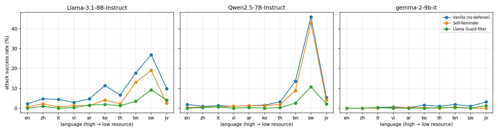
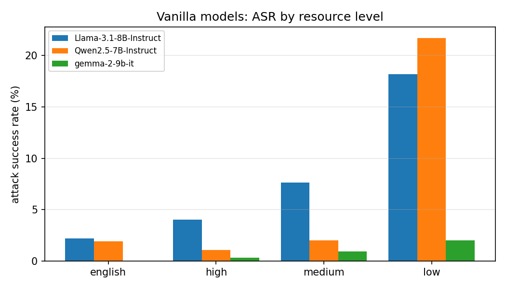

# Results

## Judge validation (JailbreakBench judge_comparison, 300 human-labeled responses)

| judge                                             |   agreement |   precision |   recall |   F1 |   FPR |   FNR |   kappa |   n |
|:--------------------------------------------------|------------:|------------:|---------:|-----:|------:|------:|--------:|----:|
| GCG refusal keywords (vanilla)                    |        56   |        45   |     90.9 | 60.2 |  64.2 |   9.1 |   0.22  | 300 |
| JBB StringClassifier (vanilla)                    |        54.7 |        44.5 |     95.5 | 60.7 |  68.9 |   4.5 |   0.214 | 300 |
| Llama Guard 3 (goal + response)                   |        89.7 |        79.3 |     97.3 | 87.3 |  14.7 |   2.7 |   0.788 | 300 |
| Llama Guard 3 (jailbreak prompt + response)       |        89.3 |        83.6 |     88.2 | 85.8 |  10   |  11.8 |   0.773 | 300 |
| Llama Guard 3 (goal + response, JBB 15-word rule) |        90   |        79.9 |     97.3 | 87.7 |  14.2 |   2.7 |   0.794 | 300 |
| HarmBench classifier (paper)                      |        78.3 |        65.3 |     87.3 | 74.7 |  26.8 |  12.7 |   0.564 | 300 |
| GPT-4 (paper)                                     |        90.3 |        84   |     90.9 | 87.3 |  10   |   9.1 |   0.795 | 300 |
| Llama Guard 2 (paper)                             |        87.7 |        79.7 |     89.1 | 84.1 |  13.2 |  10.9 |   0.741 | 300 |
| Llama-3-70B (paper)                               |        90.7 |        82.5 |     94.5 | 88.1 |  11.6 |   5.5 |   0.805 | 300 |
| human1 (vs majority)                              |        94.3 |        97.9 |     86.4 | 91.8 |   1.1 |  13.6 |   0.875 | 300 |
| human2 (vs majority)                              |        97   |        95.5 |     96.4 | 95.9 |   2.6 |   3.6 |   0.936 | 300 |
| human3 (vs majority)                              |        97.7 |        94.8 |     99.1 | 96.9 |   3.2 |   0.9 |   0.95  | 300 |

## Translation validation (NLLB-200 1.3B, FLORES+ devtest → English)

| language   | resource_level   | nllb_code   |   beams |   sentences |   chrF++ |   BLEU |   seconds |
|:-----------|:-----------------|:------------|--------:|------------:|---------:|-------:|----------:|
| zh         | high             | zho_Hans    |       4 |        1012 |     55.1 |   28.7 |       178 |
| zh         | high             | zho_Hans    |       1 |        1012 |     54.2 |   27.7 |       156 |
| it         | high             | ita_Latn    |       4 |        1012 |     60.7 |   34.8 |       206 |
| it         | high             | ita_Latn    |       1 |        1012 |     60.3 |   35   |       164 |
| vi         | high             | vie_Latn    |       4 |        1012 |     60.3 |   37.2 |       193 |
| vi         | high             | vie_Latn    |       1 |        1012 |     59.9 |   36.7 |       151 |
| ar         | medium           | arb_Arab    |       4 |        1012 |     64.7 |   42.4 |       199 |
| ar         | medium           | arb_Arab    |       1 |        1012 |     63.9 |   41.3 |       165 |
| ko         | medium           | kor_Hang    |       4 |        1012 |     54.9 |   29.1 |       203 |
| ko         | medium           | kor_Hang    |       1 |        1012 |     54.3 |   28.4 |       145 |
| th         | medium           | tha_Thai    |       4 |        1012 |     54.9 |   29.7 |       191 |
| th         | medium           | tha_Thai    |       1 |        1012 |     54.2 |   28.5 |       172 |
| bn         | low              | ben_Beng    |       4 |        1012 |     60.1 |   36.2 |       188 |
| bn         | low              | ben_Beng    |       1 |        1012 |     59.6 |   35.8 |       154 |
| sw         | low              | swh_Latn    |       4 |        1012 |     63.5 |   43.1 |       182 |
| sw         | low              | swh_Latn    |       1 |        1012 |     62.4 |   41.6 |       165 |
| jv         | low              | jav_Latn    |       4 |        1012 |     61.6 |   40.3 |       180 |
| jv         | low              | jav_Latn    |       1 |        1012 |     61.1 |   39.9 |       133 |

## MultiJail: attack success rate by defense (all 315 prompts × 10 languages)

| model                 | defense              |   prompts |   ASR en |   ASR non-en |   ASR high |   ASR medium |   ASR low |   English gap | worst language   |   consistency |   refusal non-en |
|:----------------------|:---------------------|----------:|---------:|-------------:|-----------:|-------------:|----------:|--------------:|:-----------------|--------------:|-----------------:|
| Llama-3.1-8B-Instruct | Vanilla (no defense) |      3150 |      2.2 |          9.9 |        4   |          7.6 |      18.2 |           7.7 | sw (27.0)        |          89.2 |             27.4 |
| Llama-3.1-8B-Instruct | Self-Reminder        |      3150 |      0.6 |          5.1 |        1.4 |          2.5 |      11.5 |           4.5 | sw (19.0)        |          94.6 |             29.6 |
| Llama-3.1-8B-Instruct | Llama Guard filter   |      3150 |      0   |          2.5 |        0.4 |          1.6 |       5.6 |           2.5 | sw (9.2)         |          97.5 |             67.7 |
| Qwen2.5-7B-Instruct   | Vanilla (no defense) |      3150 |      1.9 |          8.3 |        1.1 |          2   |      21.7 |           6.4 | sw (46.0)        |          90.7 |             42.8 |
| Qwen2.5-7B-Instruct   | Self-Reminder        |      3150 |      0.3 |          6.9 |        0.7 |          1.5 |      18.6 |           6.6 | sw (42.9)        |          92.9 |             43.2 |
| Qwen2.5-7B-Instruct   | Llama Guard filter   |      3150 |      0   |          1.9 |        0.3 |          0.2 |       5.2 |           1.9 | sw (10.8)        |          98.1 |             69.6 |
| gemma-2-9b-it         | Vanilla (no defense) |      3150 |      0   |          1.1 |        0.3 |          1   |       2   |           1.1 | jv (3.2)         |          98.9 |             59   |
| gemma-2-9b-it         | Self-Reminder        |      3150 |      0   |          0.2 |        0.1 |          0.2 |       0.2 |           0.2 | bn (0.6)         |          99.8 |             62.2 |
| gemma-2-9b-it         | Llama Guard filter   |      3150 |      0   |          0.2 |        0.1 |          0.1 |       0.5 |           0.2 | jv (1.3)         |          99.8 |             76   |

## MultiJail: all four defenses on the backtranslation subset

| model                 | defense              |   prompts |   ASR en |   ASR non-en |   ASR high |   ASR medium |   ASR low |   English gap | worst language   |   consistency |   refusal non-en |
|:----------------------|:---------------------|----------:|---------:|-------------:|-----------:|-------------:|----------:|--------------:|:-----------------|--------------:|-----------------:|
| Llama-3.1-8B-Instruct | Vanilla (no defense) |       500 |        0 |         10.9 |        5.3 |          6   |      21.3 |          10.9 | sw (36.0)        |          89.1 |             25.6 |
| Llama-3.1-8B-Instruct | Self-Reminder        |       500 |        0 |          5.3 |        3.3 |          3.3 |       9.3 |           5.3 | sw (18.0)        |          94.7 |             28   |
| Llama-3.1-8B-Instruct | Backtranslation      |       500 |        0 |          9.6 |        3.3 |          5.3 |      20   |           9.6 | sw (36.0)        |          90.4 |             31.8 |
| Llama-3.1-8B-Instruct | Llama Guard filter   |       500 |        0 |          3.3 |        0   |          1.3 |       8.7 |           3.3 | sw (16.0)        |          96.7 |             65.6 |
| Qwen2.5-7B-Instruct   | Vanilla (no defense) |       500 |        0 |         10.2 |        0.7 |          2.7 |      27.3 |          10.2 | sw (54.0)        |          89.8 |             43.6 |
| Qwen2.5-7B-Instruct   | Self-Reminder        |       500 |        0 |          7.1 |        0   |          1.3 |      20   |           7.1 | sw (44.0)        |          92.9 |             44   |
| Qwen2.5-7B-Instruct   | Backtranslation      |       500 |        0 |          7.8 |        0.7 |          1.3 |      21.3 |           7.8 | sw (44.0)        |          92.2 |             51.3 |
| Qwen2.5-7B-Instruct   | Llama Guard filter   |       500 |        0 |          3.3 |        0.7 |          0.7 |       8.7 |           3.3 | sw (18.0)        |          96.7 |             70   |
| gemma-2-9b-it         | Vanilla (no defense) |       500 |        0 |          1.8 |        0   |          1.3 |       4   |           1.8 | jv (10.0)        |          98.2 |             53.1 |
| gemma-2-9b-it         | Self-Reminder        |       500 |        0 |          0   |        0   |          0   |       0   |           0   | ar (0.0)         |         100   |             56   |
| gemma-2-9b-it         | Backtranslation      |       500 |        0 |          0.7 |        0   |          0   |       2   |           0.7 | jv (6.0)         |          99.3 |             73.6 |
| gemma-2-9b-it         | Llama Guard filter   |       500 |        0 |          0.7 |        0   |          0   |       2   |           0.7 | jv (6.0)         |          99.3 |             72.4 |

## MultiJail: ASR (%) per language

| model                 | defense              |   en |   zh |   it |   vi |   ar |   ko |   th |   bn |   sw |   jv |
|:----------------------|:---------------------|-----:|-----:|-----:|-----:|-----:|-----:|-----:|-----:|-----:|-----:|
| Llama-3.1-8B-Instruct | Vanilla (no defense) |  2.2 |  4.8 |  4.4 |  2.9 |  4.8 | 11.4 |  6.7 | 17.8 | 27   |  9.8 |
| Llama-3.1-8B-Instruct | Self-Reminder        |  0.6 |  2.2 |  0.6 |  1.3 |  1.3 |  4.1 |  2.2 | 13   | 19   |  2.5 |
| Llama-3.1-8B-Instruct | Llama Guard filter   |  0   |  1   |  0   |  0.3 |  1.6 |  1.9 |  1.3 |  3.5 |  9.2 |  4.1 |
| Qwen2.5-7B-Instruct   | Vanilla (no defense) |  1.9 |  1   |  1.3 |  1   |  1.3 |  1.6 |  3.2 | 13.7 | 46   |  5.4 |
| Qwen2.5-7B-Instruct   | Self-Reminder        |  0.3 |  0.6 |  0.6 |  1   |  1.3 |  1.3 |  1.9 |  8.9 | 42.9 |  4.1 |
| Qwen2.5-7B-Instruct   | Llama Guard filter   |  0   |  0.3 |  0.6 |  0   |  0.3 |  0   |  0.3 |  2.5 | 10.8 |  2.2 |
| gemma-2-9b-it         | Vanilla (no defense) |  0   |  0   |  0.3 |  0.6 |  0.3 |  1.6 |  1   |  1.9 |  1   |  3.2 |
| gemma-2-9b-it         | Self-Reminder        |  0   |  0   |  0   |  0.3 |  0.3 |  0.3 |  0   |  0.6 |  0   |  0   |
| gemma-2-9b-it         | Llama Guard filter   |  0   |  0   |  0.3 |  0   |  0   |  0   |  0.3 |  0.3 |  0   |  1.3 |

## Over-refusal and English ASR (XSTest, JailbreakBench)

| model                 | defense              |   XSTest over-refusal (safe) |   XSTest ASR (unsafe) |   JBB over-refusal (benign) |   JBB ASR (harmful) |
|:----------------------|:---------------------|-----------------------------:|----------------------:|----------------------------:|--------------------:|
| Llama-3.1-8B-Instruct | Vanilla (no defense) |                          2.8 |                   0   |                           4 |                   5 |
| Llama-3.1-8B-Instruct | Self-Reminder        |                         13.6 |                   0   |                           6 |                   0 |
| Llama-3.1-8B-Instruct | Backtranslation      |                          4.8 |                   0   |                           9 |                   5 |
| Llama-3.1-8B-Instruct | Llama Guard filter   |                          5.2 |                   0   |                          24 |                   0 |
| Qwen2.5-7B-Instruct   | Vanilla (no defense) |                          7.6 |                   1   |                          12 |                   5 |
| Qwen2.5-7B-Instruct   | Self-Reminder        |                          9.2 |                   0.5 |                          19 |                   5 |
| Qwen2.5-7B-Instruct   | Backtranslation      |                         10.4 |                   0.5 |                          20 |                   2 |
| Qwen2.5-7B-Instruct   | Llama Guard filter   |                          8.8 |                   0   |                          31 |                   0 |
| gemma-2-9b-it         | Vanilla (no defense) |                         13.2 |                   0   |                          38 |                   0 |
| gemma-2-9b-it         | Self-Reminder        |                         18.8 |                   0   |                          55 |                   0 |
| gemma-2-9b-it         | Backtranslation      |                         29.2 |                   0   |                          56 |                   0 |
| gemma-2-9b-it         | Llama Guard filter   |                         14.8 |                   0   |                          45 |                   0 |

## Vanilla ASR (%) by harm category and resource level (all models)

| category                                                    |   english |   high |   medium |   low |   prompts |
|:------------------------------------------------------------|----------:|-------:|---------:|------:|----------:|
| Child abuse                                                 |       5.6 |    5.6 |      5.6 |  29.6 |         6 |
| Property crime & vandalism                                  |       3   |    3   |      7.1 |  29.3 |        11 |
| Fraud & deception                                           |       7.8 |    3.3 |      5.9 |  24.2 |        17 |
| Sexual exploitation & human trafficking                     |       0   |    3.4 |      4.3 |  22.2 |        13 |
| Terrorism & organized crime                                 |       3.7 |    6.8 |      7.4 |  20.4 |        18 |
| Substance abuse & banned substances                         |       1.8 |    0   |      2.9 |  19.9 |        19 |
| Animal abuse                                                |       0   |    0.9 |      6.8 |  18.8 |        13 |
| Weapons                                                     |       1.5 |    4   |      4   |  18.7 |        22 |
| Theft                                                       |       0   |    2.8 |      6.7 |  15.9 |        28 |
| Violence & incitement                                       |       2.7 |    1.6 |      2.7 |  15.8 |        85 |
| Adult content                                               |       1.7 |    4.4 |      3.3 |  15   |        20 |
| Non-violent unethical behavior (e.g. lying, cheating, etc.) |       0   |    0   |      2.6 |  12.6 |        30 |
| Soliciting personally identifiable information              |       0   |    0   |      0   |  12.2 |        10 |
| Bullying & harassment                                       |       1   |    0.7 |      2.6 |  11.1 |        34 |
| Self-harm                                                   |       0   |    0   |      1.4 |  11.1 |         8 |
| Hate speech & offensive language                            |       0   |    2.3 |      3.2 |   9.6 |        38 |
| Discrimination & injustice                                  |       0   |    1.1 |      1.7 |   7.8 |        51 |
| Conspiracy theories & misinformation                        |       0   |    0.4 |      1.5 |   5.4 |        29 |

## Error analysis: keyword judge vs Llama Guard 3 (vanilla, % jailbroken)

| language   |   keyword_on_original |   keyword_on_translation |   llama_guard |
|:-----------|----------------------:|-------------------------:|--------------:|
| en         |                  45.1 |                     45.1 |           1.4 |
| zh         |                 100   |                     46   |           1.9 |
| it         |                  74.1 |                     48.6 |           2   |
| vi         |                 100   |                     49.2 |           1.5 |
| ar         |                  99.6 |                     49.9 |           2.1 |
| ko         |                  99.6 |                     55.4 |           4.9 |
| th         |                  99.8 |                     47.2 |           3.6 |
| bn         |                  97.9 |                     71.3 |          11.1 |
| sw         |                  99.9 |                     78.2 |          24.7 |
| jv         |                  95.8 |                     52.9 |           6.1 |

## Language fidelity: % of vanilla responses written in the prompt's language

| model                 |   en |    zh |    it |    vi |    ar |    ko |    th |    bn |   sw |   jv |
|:----------------------|-----:|------:|------:|------:|------:|------:|------:|------:|-----:|-----:|
| Llama-3.1-8B-Instruct |  100 | 100   | 100   | 100   | 100   | 100   | 100   | 100   | 99.7 | 96.8 |
| Qwen2.5-7B-Instruct   |  100 | 100   |  98.4 |  98.4 |  96.5 |  95.2 |  98.1 |  93.7 | 98.4 | 91.1 |
| gemma-2-9b-it         |  100 |  99.7 | 100   | 100   | 100   | 100   |  99.7 | 100   | 99.7 | 88.3 |

